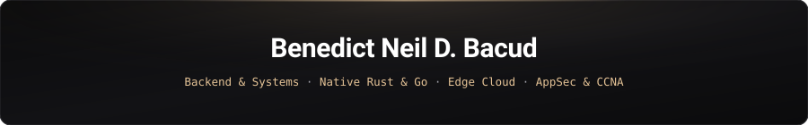

<div align="center">

<a href="https://ben-bacs.github.io/Portfolio/">
  
</a>

<br />

<p align="center">
  <samp>
    <a href="https://ben-bacs.github.io/Portfolio/"><b>portfolio</b></a> ·
    <a href="https://github.com/ben-bacs?tab=repositories"><b>repositories</b></a> ·
    <a href="https://github.com/calcom/cal.diy/pull/30158"><b>security-research</b></a> ·
    <a href="https://github.com/ben-bacs/RESONA/releases"><b>releases</b></a> ·
    <a href="https://linkedin.com"><b>linkedin</b></a> ·
    <a href="mailto:benedictneilbacud@gmail.com"><b>email</b></a>
  </samp>
</p>

I architect and engineer resilient, security-first software systems—bridging high-throughput **modular monoliths**, **native Rust/DSP desktop runtimes**, **edge-native persistence**, and **CCNA-grounded network security**.

</div>

---

### Quick Overview

-  **BS in Information Technology (BSIT 4B)** student at **West Visayas State University (WVSU) CICT**, majoring in **Network and Information Security (NIS)** & **Software Technologies (ST)**.
-  **Dual-Certified**: **Cisco Certified Network Associate (CCNA 1–3)** and **Computer Systems Servicing (CSS NC II)**.
-  **Backend & Systems Specialist**: Experienced in architecting production-grade modular monoliths, distributed services, and offline-first systems across **Java (Spring Boot 4)**, **Go (Golang)**, and **TypeScript (NestJS / Next.js / Node.js)**.
-  **Security-First Mindset**: Focused on strict Row-Level Security (RLS), multi-tenant data boundaries, OWASP mitigations, SSRF defenses, cryptographic token isolation, and revocable session architectures.
-  **Infrastructure & DevOps**: Proficient in Linux system administration (Ubuntu, Debian, Kali), Docker containerization, reverse proxy orchestration (Nginx), and automated CI/CD security gating.

---

### Featured Engineering Systems

<table>
  <tr>
    <td width="50%" valign="top">
      <h4><a href="https://github.com/ben-bacs/RESONA">RESONA (v0.1.2)</a></h4>
      <p><b>Native Rust Audio DSP &amp; WebGL2 Visualizer</b> — Ambient Windows 11 desktop visualizer using zero-permission WASAPI loopback capture, a 64-band logarithmic FFT filterbank with Hann windowing in native Rust, 8 hardware-accelerated WebGL2 scenes, and atomic filesystem persistence.</p>
      <p><samp>Rust · Tauri 2.2 · WASAPI DSP · WebGL2 · React 18 · TypeScript · GitHub Actions</samp></p>
    </td>
    <td width="50%" valign="top">
      <h4><a href="https://github.com/ben-bacs/IJWKMS---Admin-Student-Management-System">IJWKMS Next</a></h4>
      <p><b>Enterprise Academic Operations Modular Monolith</b> — Full-lifecycle student information &amp; enrollment architecture featuring BCrypt authentication, server-revocable HttpOnly cookie sessions, versioned curricula, prerequisite engines, and Flyway-managed transactional auditing.</p>
      <p><samp>Java 25 · Spring Boot 4 · PostgreSQL 17 · Flyway · React 19 · TypeScript · Docker</samp></p>
    </td>
  </tr>
  <tr>
    <td width="50%" valign="top">
      <h4><a href="https://github.com/calcom/cal.diy/pull/30158">Cal.com SSRF Defense (PR #30158)</a></h4>
      <p><b>Upstream Open-Source AppSec Contribution</b> — Engineered <code>fetchWithSSRFProtection()</code> in <code>packages/lib/ssrfProtection.ts</code> to block private IP, loopback, link-local, and cloud metadata SSRF vectors across redirect hops in external ICS calendar feeds.</p>
      <p><samp>TypeScript · Node.js · Next.js · SSRF Mitigation · Network Security · Jest</samp></p>
    </td>
    <td width="50%" valign="top">
      <h4><a href="https://github.com/ben-bacs/BENSOY">BENSOY</a></h4>
      <p><b>Edge-Native Spotify Intelligence &amp; Chronobiology</b> — Zero-tracking listening telemetry platform deployed on Cloudflare Workers &amp; D1 edge SQLite. Features AES-256-GCM token encryption at rest, scheduled cron ingestion (<code>*/30 * * * *</code>), and 24-hour circadian profiling.</p>
      <p><samp>Cloudflare Workers · Cloudflare D1 · Next.js · Drizzle ORM · AES-256-GCM · TypeScript</samp></p>
    </td>
  </tr>
  <tr>
    <td width="50%" valign="top">
      <h4><a href="https://github.com/ben-bacs/Pediatric-Clinic-Management-System-PCMS-">PCMS v2</a></h4>
      <p><b>Security-Hardened Pediatric Clinic &amp; EMR Platform</b> — Multi-role electronic medical records and clinic operations platform enforcing database-level PostgreSQL Row-Level Security (RLS), role-based access control, immunization tracking, and conflict-free scheduling.</p>
      <p><samp>Next.js App Router · Supabase Auth · PostgreSQL RLS · React 19 · TypeScript · Docker</samp></p>
    </td>
    <td width="50%" valign="top">
      <h4><a href="https://github.com/ben-bacs/HeatSafe">HeatSafe Campus</a></h4>
      <p><b>Environmental Risk &amp; Operational Decision Support</b> — Mobile-first heat-risk intelligence platform separating Open-Meteo telemetry normalization, deterministic heat-index calculation, institutional policy rules, and human-approved campus advisories.</p>
      <p><samp>Next.js 16 · React 19 · Supabase PostgreSQL · RLS · Open-Meteo API · Tailwind CSS</samp></p>
    </td>
  </tr>
</table>

---

### Complete Repository & System Index

| System / Repository | Domain & Architectural Highlights | Stack | Links |
| :--- | :--- | :--- | :--- |
| **[RESONA](https://github.com/ben-bacs/RESONA)** | Native Windows 11 WASAPI loopback 64-band FFT audio visualizer & 8 WebGL2 shader presets | `Rust` `Tauri 2.2` `WebGL2` `TypeScript` | [Source](https://github.com/ben-bacs/RESONA) · [Releases](https://github.com/ben-bacs/RESONA/releases) |
| **[IJWKMS Next](https://github.com/ben-bacs/IJWKMS---Admin-Student-Management-System)** | Enterprise academic operations modular monolith with RBAC, Flyway migrations & audit trails | `Java 25` `Spring Boot 4` `PostgreSQL 17` | [Source](https://github.com/ben-bacs/IJWKMS---Admin-Student-Management-System) |
| **[BENSOY](https://github.com/ben-bacs/BENSOY)** | Private edge-native Spotify chronobiology analytics with AES-256-GCM encrypted tokens | `Cloudflare Workers` `D1` `Drizzle ORM` | [Source](https://github.com/ben-bacs/BENSOY) |
| **[PCMS v2](https://github.com/ben-bacs/Pediatric-Clinic-Management-System-PCMS-)** | Healthcare EMR & pediatric clinic operations with strict PostgreSQL Row-Level Security | `Next.js` `Supabase` `PostgreSQL RLS` | [Source](https://github.com/ben-bacs/Pediatric-Clinic-Management-System-PCMS-) |
| **[HeatSafe Campus](https://github.com/ben-bacs/HeatSafe)** | Deterministic heat-index engine & auditable campus advisory decision-support platform | `Next.js 16` `React 19` `Supabase` | [Source](https://github.com/ben-bacs/HeatSafe) |
| **[Cal.com SSRF Fix](https://github.com/calcom/cal.diy/pull/30158)** | Upstream SSRF defense guard with redirect hop validation & DNS/private-IP isolation | `TypeScript` `Node.js` `Jest` `AppSec` | [PR #30158](https://github.com/calcom/cal.diy/pull/30158) |
| **A.C.A.M.S. ROTC-AF** | Offline-first, multi-tenant military/ROTC muster platform with sub-10ms p99 query latency | `Go 1.24` `PostgreSQL 16` `Docker` `RLS` | *Private System* |
| **Secure Service Desk** | Multi-tenant ITSM modular monolith with Argon2id, rotating refresh tokens & OpenAPI | `NestJS 11` `PostgreSQL 17` `Prisma` | *Internal Monolith* |
| **[AutoRest Sleep PWA](https://github.com/ben-bacs/Sleep-Tracker)** | Zero-server-cost OLED sleep debt & circadian recovery PWA with Web Audio noise synthesis | `React 19` `TypeScript` `Web Audio API` | [Live App](https://ben-bacs.github.io/Sleep-Tracker/) · [Source](https://github.com/ben-bacs/Sleep-Tracker) |
| **[BSIT 4B Academic Hub](https://github.com/ben-bacs/bsit4b-nis-st)** | Interactive 479-slide lecture portal for CIT 245 (Cyberforensics) & CIT 220 (InfoSec 2) | `React` `TypeScript` `Vite` `Tailwind` | [Live Portal](https://ben-bacs.github.io/bsit4b-nis-st/) · [Source](https://github.com/ben-bacs/bsit4b-nis-st) |
| **[A Day of Reset](https://github.com/ben-bacs/wellness-journal-presentation)** | 24-hour circadian wellness protocol deck with client-side `.pptx` export & Strava telemetry | `React` `TypeScript` `PptxGenJS` | [Live Deck](https://ben-bacs.github.io/wellness-journal-presentation/) · [Source](https://github.com/ben-bacs/wellness-journal-presentation) |
| **[Developer Portfolio](https://github.com/ben-bacs/Portfolio)** | Luxury dark-mode engineering portfolio with interactive architecture inspection modals | `React` `TypeScript` `Framer Motion` | [Live Site](https://ben-bacs.github.io/Portfolio/) · [Source](https://github.com/ben-bacs/Portfolio) |

---

### Technical Matrix & Toolchain

```text
Languages & Systems    :: Java 25 · Rust (1.78+) · Go (1.24) · TypeScript · SQL (PostgreSQL / SQLite) · Python · Bash
Backend & Native       :: Spring Boot 4 · Tauri 2.2 (WASAPI DSP) · NestJS 11 · Next.js 16 · Node.js · REST / OpenAPI
Data & Edge Runtimes   :: PostgreSQL 16/17 (RLS) · Cloudflare Workers & D1 · Supabase · Flyway · Prisma · Drizzle ORM
Frontend & Graphics    :: React 19 · WebGL2 GLSL Shaders · Web Audio API · Tailwind CSS · Framer Motion · Vite · PWA
Security & Networking  :: OWASP Top 10 · SSRF Defense · Argon2id / BCrypt · AES-256-GCM · Cisco CCNA (1–3) · Cyberforensics
Infrastructure & Ops   :: Linux (Ubuntu / Debian / Kali) · Docker & Compose · Nginx · GitHub Actions CI/CD · WiX / NSIS
```

<p align="left">
  
  
  
  
  
  
  
  
  
  
  
  
  
  
  
</p>

---

### Architectural Invariants & Security Research

> **Case Study — [Cal.com (`calcom/cal.diy`) SSRF Mitigation (PR #30158)](https://github.com/calcom/cal.diy/pull/30158)**
> Decrypted external ICS calendar URLs and third-party AvatarAPI responses were previously passed directly to server-side `fetch()`, exposing internal network interfaces and cloud metadata endpoints to Server-Side Request Forgery. I designed and implemented `fetchWithSSRFProtection()` in `packages/lib/ssrfProtection.ts`—enforcing strict IP/hostname validation across redirect hops, capping maximum redirects, isolating multi-feed failures with `Promise.allSettled()`, and verifying coverage against loopback, link-local, private RFC 1918 ranges, and DNS rebinding vectors.

---

## Open Source & Vulnerability Research

### [Cal.com (cal.diy) — SSRF Vulnerability Mitigation (PR #30158)](https://github.com/calcom/cal.diy/pull/30158)
- **Problem**: Decrypted external ICS feed URLs and third-party AvatarAPI responses were passed directly to server-side `fetch()`, introducing Server-Side Request Forgery risks against internal network infrastructure and cloud metadata services.
- **Solution**: Designed and implemented `fetchWithSSRFProtection()` in `packages/lib/ssrfProtection.ts`. Enforced strict destination validation across redirects, capped maximum hops, isolated multi-feed fetching via `Promise.allSettled()`, and wrote a complete test suite verifying loopback, link-local, private IP, and DNS-rebinding cases.

---

## Certifications & Credentials

-  **Cisco Certified Network Associate (CCNA)**
  - *CCNA 1*: Introduction to Networks
  - *CCNA 2*: Switching, Routing, and Wireless Essentials
  - *CCNA 3*: Enterprise Networking, Security, and Automation
-  **TESDA Computer Systems Servicing (CSS NC II)** — National Certificate Level II
-  **Bachelor of Science in Information Technology (BSIT)** — West Visayas State University

---

## Engineering Invariants

1. **Authorization is a Server-Side Invariant**: Client-side state is never trusted. All access control is authoritatively verified via database Row-Level Security (RLS) or middleware RBAC guards.
2. **Defensive Boundaries**: Validate, normalize, and constrain all external inputs (Open-Meteo, Spotify API, calendar feeds) before ingestion.
3. **Cryptographic Rigor**: Passwords hashed with Argon2id or BCrypt; tokens encrypted with AES-256-GCM at rest; sessions maintained via opaque, server-revocable HttpOnly SameSite tokens.
4. **Offline Resilience & Data Sovereignty**: Prioritize offline-first architectures (AutoRest, ACAMS) and edge persistence (Cloudflare Workers/D1) to eliminate latency and cloud vendor lock-in.
5. **Observability & Auditing**: Maintain immutable, append-only audit event logs across all mutations and operational workflows.

---

<div align="center">

<samp>Open to Backend Engineering, Systems Architecture, Full-Stack &amp; Application Security Opportunities</samp>

<br /><br />

[](https://ben-bacs.github.io/Portfolio/)
[](mailto:benedictneilbacud@gmail.com)

</div>
